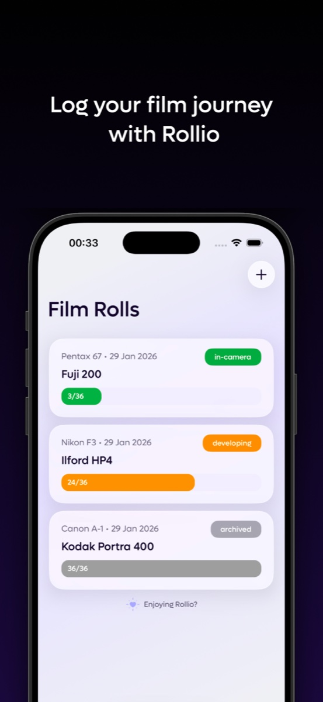
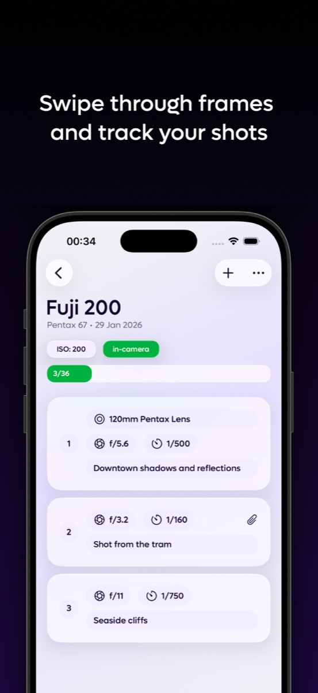
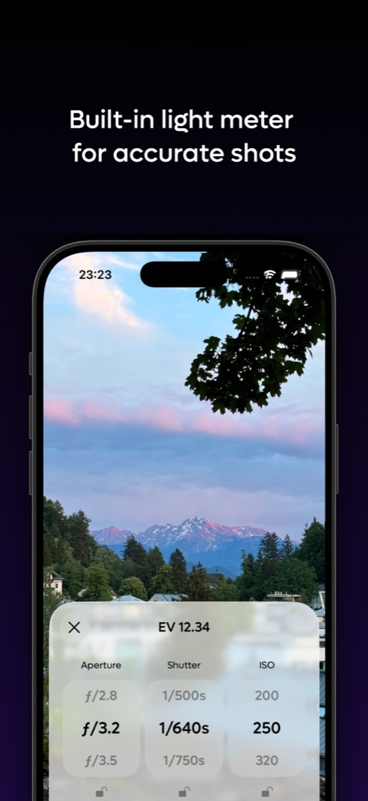

# 🎞️ Rollio – Film Photography Log and Light Meter

**Rollio** is an app for film photographers on iPhone, iPad and Android: a log for every roll and frame, with a built-in light meter that saves each reading to the frame you are about to shoot.

No logins. No cloud. Just you, your camera, and the notes that matter.

---

## ✨ Features

- 📷 Create film rolls with film stock, ISO, push/pull and the camera used, and move them from in camera to developing to archived
- 📝 Log every frame with aperture, shutter speed, lens and notes. A new frame starts from the settings of the one before, and a blank frame can be logged as skipped
- ☀️ Built-in light meter that reads a scene through the camera, lets you lock aperture, shutter speed or ISO, and hands the result straight to a new frame
- 🌙 Exposure planner: the same calculator without a reading, with sixteen kinds of light from snow in full sun to moonlight
- 🧩 Widgets that show the roll in your camera and log a frame or open the light meter in one tap: Home Screen and Lock Screen on iOS, Home Screen on Android
- 🖼 Attach a photo to a frame, and let Rollio suggest the settings from its EXIF data
- 📍 Save where you shot: an optional GPS spot per frame, shown as a pin on the roll and opened in your maps app
- 📄 Export a roll as a print-ready PDF contact sheet or a CSV spreadsheet
- 💾 Back up every roll, frame and photo to a single `.rollio` file, and restore it on any phone
- ⚙️ Choose the tab Rollio opens on, and see what changed after an update
- 🌍 Available in English, Japanese and Korean
- 🔒 Works offline – all data is stored locally on your device, with no account and no analytics
- 🧘 Minimal UI designed for focus and speed

### What Rollio does not do

- It does not sync between devices. To move the log, make a backup file and restore it on the other phone
- The light meter reads reflected light. It does not measure flash or incident light
- It has no web or desktop version

---

## 📱 Platforms

- **iOS:** Available on the [App Store](https://apps.apple.com/app/rollio-analog-photography-log/id6744120369)
- **Android:** Available on [Google Play](https://play.google.com/store/apps/details?id=com.davitpodosyan.rollio)
- **Website:** [rollio.davitp.dev](https://rollio.davitp.dev)

Rollio needs iOS 16.4 or later, or Android 8 or later.

On the website: [what Rollio is and is not](https://rollio.davitp.dev/what-is-rollio/), the [light meter](https://rollio.davitp.dev/light-meter-app/), the [film log](https://rollio.davitp.dev/film-photography-log/), and [light meter guides for single film cameras](https://rollio.davitp.dev/cameras/).

---

## 📸 Screenshots

  
  
  

---

## 🛠 Built With

- [Expo](https://expo.dev/) and [Expo Router](https://docs.expo.dev/router/introduction/)
- [React Native](https://reactnative.dev/)
- [Expo SQLite](https://docs.expo.dev/versions/latest/sdk/sqlite/)
- [react-native-vision-camera](https://react-native-vision-camera.com/) for the light meter
- [expo-widgets](https://www.npmjs.com/package/expo-widgets) on iOS and [react-native-android-widget](https://www.npmjs.com/package/react-native-android-widget) on Android for the widgets
- [i18next](https://www.i18next.com/) for localization – see [Adding a language](./i18n/ADDING_A_LANGUAGE.md)

---

## 🔐 Privacy

Rollio keeps everything on your device. Read the [privacy policy](./privacy-policy.md).

---

## 📄 License

MIT License — see [LICENSE](./LICENSE) for details.

---

## ❤️ Acknowledgments

Thanks to the awesome [analog photography community on Reddit](https://www.reddit.com/r/AnalogCommunity/) for the feedback, support, and feature suggestions!

---

*Film is not dead 🎞*
