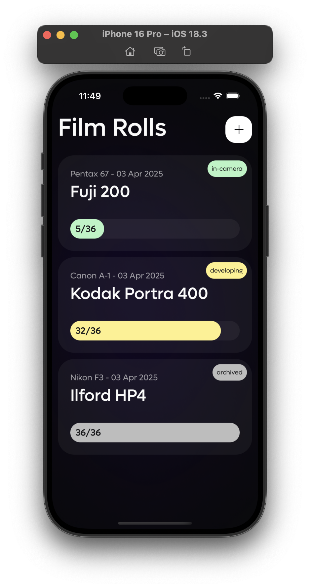
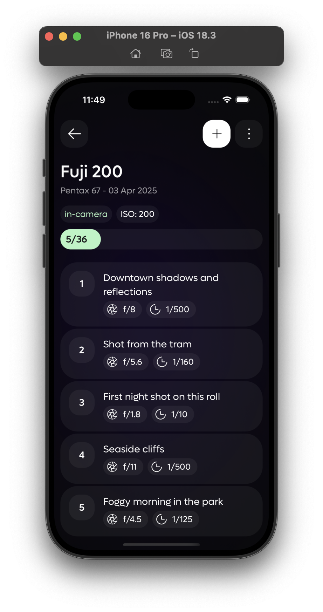
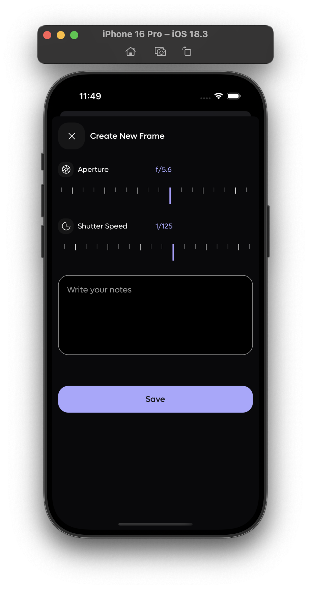

# 🎞️ Rollio – Analog Photography Log

**Rollio** is a simple and elegant app for analog photographers to track their film rolls and individual frames.

No logins. No cloud. Just you, your camera, and the notes that matter.

---

## ✨ Features

- 📷 Create film rolls with film stock, ISO, push/pull and the camera used, and move them from in camera to developing to archived
- 📝 Log every frame with aperture, shutter speed, lens and notes
- 🖼 Attach a photo to a frame, and let Rollio suggest the settings from its EXIF data
- ☀️ Built-in light meter that reads a scene through the camera and hands the result straight to a new frame
- 📍 Save where you shot: an optional GPS spot per frame, shown as a pin on the roll and opened in your maps app
- 📄 Export a roll as a print-ready PDF contact sheet or a CSV spreadsheet
- 💾 Back up every roll, frame and photo to a single `.rollio` file, and restore it on any phone
- ⚙️ Choose the tab Rollio opens on, and see what changed after an update
- 🌍 Available in English, Japanese and Korean
- 🔒 100% offline – all data is stored locally on your device
- 🧘 Minimal UI designed for focus and speed

---

## 📱 Platforms

- **iOS:** Available on the [App Store](https://apps.apple.com/app/rollio-analog-photography-log/id6744120369)
- **Android:** Available on [Google Play](https://play.google.com/store/apps/details?id=com.davitpodosyan.rollio)

---

## 📸 Screenshots

---

## 🛠 Built With

- [Expo](https://expo.dev/) and [Expo Router](https://docs.expo.dev/router/introduction/)
- [React Native](https://reactnative.dev/)
- [Expo SQLite](https://docs.expo.dev/versions/latest/sdk/sqlite/)
- [react-native-vision-camera](https://react-native-vision-camera.com/) for the light meter
- [i18next](https://www.i18next.com/) for localization – see [Adding a language](./i18n/ADDING_A_LANGUAGE.md)

---

## 🔐 Privacy

Rollio keeps everything on your device. Read the [privacy policy](./privacy-policy.md).

---

## 📄 License

MIT License — see [LICENSE](./LICENSE) for details.

---

## ❤️ Acknowledgments

Thanks to the awesome [analog photography community on Reddit](https://www.reddit.com/r/AnalogCommunity/) for the feedback, support, and feature suggestions!

---

*Film is not dead 🎞*
